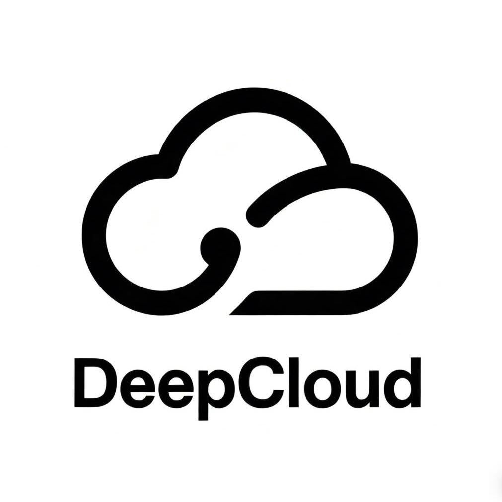

<div align="center">



# Video Flow

### Turn YouTube and Bilibili videos into notes

A Chrome side panel that turns YouTube and Bilibili videos into searchable learning notes. Video Flow is maintained by DeepCloud (深度云创科技).

[](https://github.com/crazymsn/video-flow) [](https://chromewebstore.google.com/detail/aoedmdjacbdcfoljcehedcdoplndihdn) [](LICENSE)<br>
   

**[Chrome Web Store](https://chromewebstore.google.com/detail/aoedmdjacbdcfoljcehedcdoplndihdn)** &nbsp;·&nbsp; **[Privacy](PRIVACY.md)** &nbsp;·&nbsp; **[Security](SECURITY.md)** &nbsp;·&nbsp; **简体中文: [README.zh-CN.md](README.zh-CN.md)**

</div>

## Features

- **Timestamped transcripts**: read and search the full transcript, and click a line to jump to that moment in the video.
- **Original, Chinese, and bilingual views**: switch between the source text, a translation, or both together.
- **AI overview**: a video summary, chapters, and key quotes.
- **Selected-text explanations**: select any passage to get an explanation in context.
- **Timestamped notes**: save notes tied to the moment in the video they refer to.
- **Local storage**: keys, settings, and notes stay in Chrome, with no account, analytics, or telemetry.

## Install

**From the Chrome Web Store (recommended)**

1. Open the [Video Flow page on the Chrome Web Store](https://chromewebstore.google.com/detail/aoedmdjacbdcfoljcehedcdoplndihdn).
2. Click **Add to Chrome**.
3. Pin Video Flow to the toolbar and open its **Settings** page.

**From source**

1. Download or clone this repository into a permanent folder.
2. Open `chrome://extensions` in Chrome.
3. Enable **Developer mode**.
4. Click **Load unpacked** and select the folder containing `manifest.json`.
5. Reload the extension after updating local files.

Keep the project folder in the same location. Chrome will stop loading an unpacked extension if the folder is moved or deleted.

## Configure

Video Flow uses your own keys for two services. Enter both in Video Flow **Settings**.

**AI gateway (API distribution site)**: used for summaries, explanations, translation, and note polishing.

1. Open [https://api.meding.site](https://api.meding.site) and create an API token.
2. Open Video Flow **Settings** and paste the token.
3. Choose a model and save.

The AI Base URL is fixed in the published extension:

```text
https://api.meding.site
```

**Supadata**: needed only for YouTube subtitles. Create a key at [Supadata](https://dash.supadata.ai/auth/sign-up). Bilibili does not need a Supadata key.

## Use

1. Open a captioned YouTube video or a subtitled Bilibili video.
2. Click the Video Flow extension icon to open the side panel.
3. Read and search the transcript.
4. Open **概览** for the video summary, chapters, and key quotes.
5. Select text for an explanation, or save timestamped notes.

Videos without an available transcript or subtitle track may not work.

## Privacy and security

- Keys, settings, notes, and recent cache stay in Chrome local storage.
- YouTube transcript requests go to Supadata.
- Bilibili subtitle requests go to Bilibili services from your browser.
- AI features send the required transcript and video context to the AI gateway.
- Video Flow has no account system, analytics, advertising, or telemetry.

Never put keys in chat messages, source files, screenshots, or public issues. See [PRIVACY.md](PRIVACY.md) for the full data flow and [SECURITY.md](SECURITY.md) for reporting a vulnerability.

## Development

```bash
npm test
npm run check
npm run package
```

`npm run package` writes the release ZIP to `dist/`.

## Contact us


For product support, help deploying AI agents for individuals or companies, or business cooperation, scan the QR code to contact DeepCloud (深度云创科技).

## License

[MIT](LICENSE)
