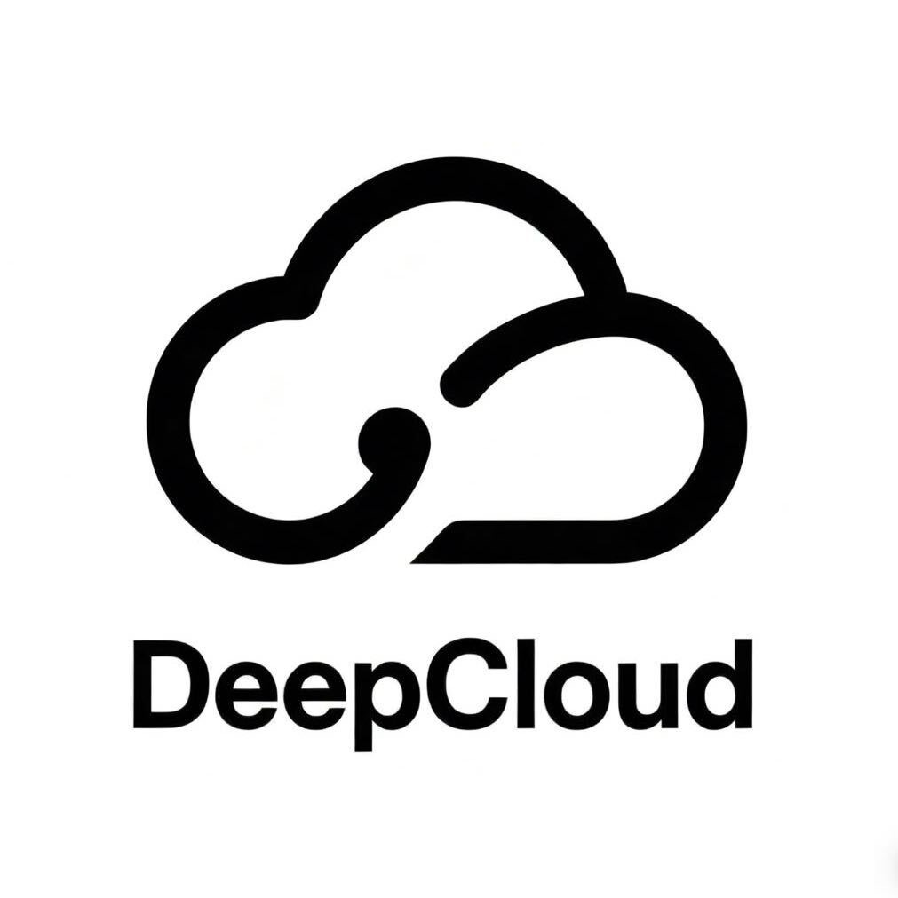

<div align="center">



# Video Flow

### 把 YouTube、Bilibili 视频变成笔记

Video Flow 是一个 Chrome 侧边栏扩展，可以把 YouTube 和 Bilibili 视频变成可搜索、可复习的学习资料。由深度云创科技（DeepCloud）维护。

[](https://github.com/crazymsn/video-flow) [](https://chromewebstore.google.com/detail/aoedmdjacbdcfoljcehedcdoplndihdn) [](LICENSE)<br>
   

**[Chrome 应用商店](https://chromewebstore.google.com/detail/aoedmdjacbdcfoljcehedcdoplndihdn)** &nbsp;·&nbsp; **[隐私说明](PRIVACY.md)** &nbsp;·&nbsp; **[安全说明](SECURITY.md)** &nbsp;·&nbsp; **English: [README.md](README.md)**

</div>

## 核心能力

- **带时间戳的字幕**：阅读和搜索完整字幕，点击任意一行跳到视频对应的位置。
- **原文、中文和双语模式**：在原文、译文和双语对照之间切换。
- **AI 概览**：视频总结、章节和关键摘录。
- **选中文本讲解**：选中任意一段文字，结合上下文获得讲解。
- **带时间戳的笔记**：笔记和视频里的具体时间点绑定。
- **本地保存**：Key、设置和笔记都保存在 Chrome 本地，没有账号、分析统计或行为追踪。

## 安装

**从 Chrome 应用商店安装（推荐）**

1. 打开 [Chrome 应用商店的 Video Flow 页面](https://chromewebstore.google.com/detail/aoedmdjacbdcfoljcehedcdoplndihdn)。
2. 点击 **添加至 Chrome**。
3. 把 Video Flow 固定到工具栏，然后打开扩展的 **设置** 页面。

**从源码加载**

1. 把项目下载或克隆到一个长期保留的文件夹。
2. 在 Chrome 打开 `chrome://extensions`。
3. 打开 **开发者模式**。
4. 点击 **加载已解压的扩展程序**，选择包含 `manifest.json` 的项目文件夹。
5. 修改本地文件后，在扩展页面点击 **重新加载**。

不要移动或删除项目文件夹，否则 Chrome 会停止加载这个本地扩展。

## 配置

Video Flow 使用你自己的 Key 连接两个服务，都在 Video Flow 的 **设置** 页面填写。

**AI 网关（API 分发站）**：用于视频总结、讲解、翻译和笔记润色。

1. 打开 [https://api.meding.site](https://api.meding.site) 创建 API 令牌。
2. 打开 Video Flow 的 **设置** 页面，填入令牌。
3. 选择模型并保存。

发布版本的 AI Base URL 固定为：

```text
https://api.meding.site
```

**Supadata**：只有 YouTube 字幕需要。可以在 [Supadata](https://dash.supadata.ai/auth/sign-up) 创建密钥。Bilibili 不需要 Supadata Key。

## 使用

1. 打开一个有字幕的 YouTube 视频或有字幕轨道的 Bilibili 视频。
2. 点击 Video Flow 扩展图标，打开侧边栏。
3. 阅读和搜索字幕。
4. 打开 **概览**，查看视频总结、章节和关键摘录。
5. 选中文本获取讲解，或保存带时间戳的笔记。

没有可用字幕轨道的视频可能无法使用。

## 隐私与安全

- Key、设置、笔记和最近缓存保存在 Chrome 本地。
- YouTube 字幕请求发送到 Supadata。
- Bilibili 字幕请求由浏览器发送到 Bilibili 服务。
- AI 功能会把所需字幕和视频上下文发送到 AI 网关。
- Video Flow 没有账号系统、广告、分析统计或行为追踪。

不要把 Key 放进聊天、源代码、截图或公开 Issue。完整数据流请查看 [PRIVACY.md](PRIVACY.md)，报告安全问题请查看 [SECURITY.md](SECURITY.md)。

## 开发

```bash
npm test
npm run check
npm run package
```

`npm run package` 会把发布用的 ZIP 生成到 `dist/` 目录。

## 联系我们


如需产品支持、个人及企业智能体部署协助或商务合作，请扫描二维码联系深度云创科技（DeepCloud）。

## 开源许可

[MIT](LICENSE)
